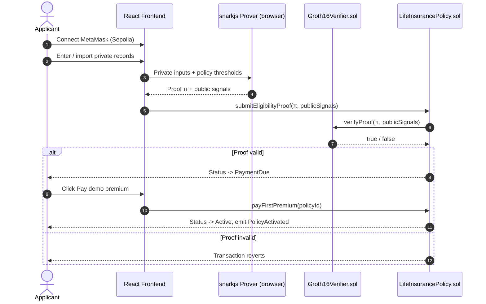
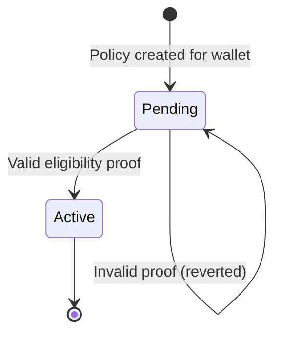

<div align="center">

# 🛡️ InsureChain

### Privacy-First Life Insurance Onboarding with Zero-Knowledge Proofs

**Prove eligibility. Reveal nothing.**


</div>

---

## Table of Contents

1. [Overview](#1-overview)
2. [The Problem](#2-the-problem)
3. [Our Solution](#3-our-solution)
4. [Key Features](#4-key-features)
5. [System Architecture](#5-system-architecture)
6. [Zero-Knowledge Circuit Specification](#6-zero-knowledge-circuit-specification)
7. [Smart Contracts](#7-smart-contracts)
8. [Technology Stack](#8-technology-stack)
9. [Repository Structure](#9-repository-structure)
10. [Getting Started](#10-getting-started)
11. [Deployment Guide](#11-deployment-guide)
12. [Testing](#12-testing)
13. [Security & Privacy Model](#13-security--privacy-model)
14. [Cryptographic Integrity Notice](#14-cryptographic-integrity-notice)
15. [Roadmap](#15-roadmap)
16. [Troubleshooting](#16-troubleshooting)
17. [Contributing](#17-contributing)
18. [Disclaimer](#18-disclaimer)
19. [License](#19-license)
20. [References](#20-references)

---

## 1. Overview

**InsureChain** is a decentralized application (DApp) that automates **life insurance policy onboarding and disbursement** using **smart contracts** and **Zero-Knowledge Proofs (ZKPs)**.

Applicants prove that they satisfy a policy's financial and health eligibility thresholds **without ever disclosing the underlying sensitive records** — income, credit score, or medical risk — to the insurer or to the public blockchain. Proofs are generated **client-side** using **Circom** circuits and the **Groth16** proving system, then verified on the configured chain. A simulated first-premium confirmation activates the demo policy; it does not charge or transfer money.

> **In one sentence:** InsureChain replaces document-heavy, trust-based underwriting with cryptographic proof — verifiable by anyone, readable by no one.

---

## 2. The Problem

Traditional life insurance onboarding suffers from structural inefficiencies:

| Challenge | Impact |
|---|---|
| **Excessive data exposure** | Applicants must hand over complete medical and financial histories to multiple intermediaries |
| **Centralized data custody** | Insurers become high-value targets for breaches |
| **Manual underwriting** | Slow review cycles; delays of days to weeks are common |
| **Opaque decisions** | Applicants cannot independently verify how eligibility was determined |
| **Fragile claim settlement** | Disbursement depends on manual validation and back-office processing |

Storing raw records on a public blockchain is not a solution either: on-chain data is transparent and permanent, which makes it fundamentally incompatible with sensitive personal information.

---

## 3. Our Solution

InsureChain applies the principle of **proving a predicate about private data** rather than sharing the data itself.

```
   PRIVATE (never leaves the user's device)         PUBLIC (on-chain)
 ┌──────────────────────────────────────────┐    ┌──────────────────────────┐
 │  income, creditScore, medicalRisk        │    │  eligible (0 / 1)        │
 └──────────────────────────────────────────┘    │  minIncome               │
                    │                            │  minCreditScore          │
                    ▼                            │  maxMedicalRisk          │
        ┌───────────────────────┐                └──────────────────────────┘
        │  Circom circuit +     │  ── π (proof) ──────────▲
        │  Groth16 prover       │
        └───────────────────────┘
```

The smart contract learns only **one fact**: *"this wallet satisfies the policy thresholds."* It learns nothing about *how far* above the thresholds the applicant is.

---

## 4. Key Features

- 🔐 **Issuer-attested zero-knowledge eligibility** — private values are checked against policy thresholds and signed issuer credentials
- 🪪 **Credential lifecycle** — wallet-bound signatures, expiry, active-registry Merkle membership, and root-based revocation
- 🔁 **Replay and context protection** — proofs bind to the policy, wallet, registry root, and policy nonce
- 📊 **Groth16 / PLONK comparison** — local benchmark scripts report proof size, proving time, and verification time
- 🧮 **Client-side proving** — sensitive data never leaves the applicant's browser
- ⛓️ **On-chain verification** — Groth16 verifier contract generated from the circuit's own proving key
- **Demo first-premium gate** - proof validation sets PaymentDue; a simulated payment click activates the policy without transferring funds.
- 🦊 **MetaMask integration** — wallet address serves as the policyholder identity
- 🌐 **Sepolia network handling** — built-in network detection and switching
- 🧪 **Reproducible ZKP pipeline** — one-command scripts for setup, proving, and verification
- 🧰 **Full test harness** — Hardhat contract tests plus a development-only mock verifier
- 📐 **Documented architecture** — extension path for ZK-based claim disbursement

---

## 5. System Architecture

### 5.1 High-Level Flow



### 5.2 Component Responsibilities

| # | Component | Responsibility |
|---|---|---|
| 1 | **Wallet / Identity** | MetaMask connects the user; the wallet address is registered as the policyholder |
| 2 | **Private Records** | Financial / medical data is sourced privately. Raw records are **never** sent to the blockchain |
| 3 | **ZKP Prover** | Circom circuit proves threshold predicates and outputs a Groth16 proof |
| 4 | **On-chain Verifier** | `Groth16Verifier.sol`, generated from the final `zkey`, validates the proof |
| 5 | **Policy Contract** | `LifeInsurancePolicy.sol` calls the verifier and manages the policy state machine |
| 6 | **Disbursement Extension** | Proof-driven claim settlement (see [Roadmap](#15-roadmap)) |

### 5.3 Policy State Machine



---

## 6. Zero-Knowledge Circuit Specification

The eligibility circuit is written in **Circom 2.1.1** and proves three conjunctive predicates.

### 6.1 Statement Being Proved

```
income        ≥ minIncome
creditScore   ≥ minCreditScore
medicalRisk   ≤ maxMedicalRisk
```

### 6.2 Signals

| Signal | Visibility | Description |
|---|---|---|
| `income` | 🔒 **Private** | Applicant's income |
| `creditScore` | 🔒 **Private** | Applicant's credit score |
| `medicalRisk` | 🔒 **Private** | Applicant's medical risk score |
| `eligible` | 🌍 **Public** | `1` if all three predicates hold |
| `minIncome` | 🌍 **Public** | Policy's minimum income threshold |
| `minCreditScore` | 🌍 **Public** | Policy's minimum credit score threshold |
| `maxMedicalRisk` | 🌍 **Public** | Policy's maximum permitted medical risk |

> ⚠️ **Public signal ordering matters.** The verifier expects signals in this exact order:
> **`eligible`, `minIncome`, `minCreditScore`, `maxMedicalRisk`**.
> Any mismatch between the frontend, the contract call, and the circuit will cause verification to fail.

### 6.3 Proving System

| Property | Value |
|---|---|
| Proving system | **Groth16** |
| Circuit language | **Circom 2.1.1** |
| Toolchain | **snarkjs** |
| Proof location | Client-side (WASM in browser) |
| Verification location | On-chain (Solidity verifier) |

---

## 7. Smart Contracts

| Contract | Purpose | Production-safe? |
|---|---|---|
| `LifeInsurancePolicy.sol` | Core policy logic. Accepts proofs, calls the verifier, activates the policy, emits events | ✅ (after audit) |
| `Groth16Verifier.sol` | Auto-generated verifier bound to the circuit's final `zkey` | ✅ (with a trusted setup) |
| `MockZKPVerifier.sol` | Accepts **any** proof — exists only to test transaction flow | ❌ **Never** |

### Events

| Event | Emitted when |
|---|---|
| PolicyActivated | The simulated first-premium action is recorded and the policy becomes Active |

---

## 8. Technology Stack

| Layer | Technology |
|---|---|
| **Frontend** | React, Vite |
| **Wallet** | MetaMask (Sepolia testnet) |
| **ZK Circuits** | Circom 2.1.1 |
| **Proof System** | Groth16 via snarkjs |
| **Smart Contracts** | Solidity |
| **Contract Tooling** | Hardhat |
| **Network** | Ethereum (Sepolia) |

---

## 9. Repository Structure

```
InsureChain/
├── backend/                  # Backend services
├── circuits/                 # Circom circuit source (eligibility predicate)
├── contracts/                # Solidity contracts (policy, verifier, mock verifier)
├── public/zkp/               # Browser-side proving artifacts (circuit WASM + final zkey)
├── scripts/                  # Deployment and helper scripts
├── src/                      # React frontend source
├── zkp/                      # ZKP build outputs & setup artifacts
├── ENV.example               # Environment variable template
├── hardhat.config.cjs        # Hardhat configuration
├── index.html                # Vite entry point
├── package.json              # Dependencies and npm scripts
├── vite.config.js            # Vite configuration
├── PROJECT_ARCHITECTURE.md   # Detailed architecture notes
├── RUN_APPLICATION.md        # Run instructions
├── SETUP_WINDOWS.md          # Windows-specific setup
└── README.md                 # You are here
```

---

## 10. Getting Started

### 10.1 Prerequisites

| Requirement | Notes |
|---|---|
| **Node.js** (LTS) and **npm** | Required for all tooling |
| **Circom 2.1.1** | Required for compiling the circuit |
| **MetaMask** | Browser extension, configured for Sepolia |
| **Sepolia ETH** | Needed for deployment and transactions (use a faucet) |
| **Git** | To clone the repository |

> 🪟 On Windows? See [`SETUP_WINDOWS.md`](./SETUP_WINDOWS.md).

### 10.2 Installation

```bash
git clone https://github.com/achotanibhavikoffice-ui/InsureChain.git
cd InsureChain
npm install
```

### 10.3 Environment Configuration

```bash
cp ENV.example .env.local
```

Then populate the values:

| Variable | Description |
|---|---|
| `VERIFIER_ADDRESS` | Address of the deployed `Groth16Verifier` contract |
| `VITE_POLICY_CONTRACT_ADDRESS` | Address of the deployed `LifeInsurancePolicy` contract |

> Refer to `ENV.example` for the complete list (e.g., RPC URL and deployer key). **Never commit real private keys.**

### 10.4 First-Time Setup

Generate the circuit setup and both proof-system artifacts, then create a local demo issuer and issue a credential for a Hardhat wallet:

```bash
npm run contracts:compile
npm run zkp:setup
npm run zkp:issuer:init
npm run zkp:issuer:issue -- 0xYOUR_WALLET 850000 760 25 1893456000
npm run contracts:test
npm run zkp:test:circuit
npm run zkp:compare
npm run zkp:compare:gas
```

**What `zkp:setup` produces:**

1. A local, **development-only** Powers of Tau setup
2. Circuit-specific Groth16 and PLONK proving keys and verification keys
3. Browser Groth16 WASM, proving key, and verification key in `public/zkp/`
4. `contracts/Groth16Verifier.sol` and `contracts/PlonkVerifier.sol`
5. Adversarial circuit checks and local proof-system benchmark scripts

The default local Powers of Tau size is power 16 so the PLONK setup fits this circuit. `zkp:compare` reports proof size and prover/verifier timing. `zkp:compare:gas` deploys both generated verifier contracts to an ephemeral Hardhat EVM and records their verification gas estimates.

Run `npm run zkp:issuer:init` only once for the local issuer. Its secret key is written to the ignored file `zkp/issuer-private.json`. To issue a credential, pass the applicant wallet, income, credit score, medical risk, and future Unix expiry. The resulting `zkp/credentials/<id>.json` is imported in the app. After any issue or revoke operation, redeploy the policy or run `npm run zkp:publish-root` against the existing local deployment so its active root matches the issuer registry. The owner account must be the Hardhat account #1 used by the deploy script.

On Windows PowerShell use `npm.cmd` in place of `npm`.

### 10.5 Run the Frontend

```bash
npm run dev
```

Open the local URL printed by Vite, connect MetaMask to the configured network, select the issued credential JSON, and begin the onboarding flow. See [`RUN_APPLICATION.md`](./RUN_APPLICATION.md) for details.

---

## 11. Deployment Guide

Deployment must follow this order, because the policy contract depends on the verifier address.

| Step | Action |
|---|---|
| **1** | Initialize the demo issuer and issue credentials; this creates the registry root and issuer public key |
| **2** | Compile the generated `Groth16Verifier.sol` and deploy it |
| **3** | Deploy `LifeInsurancePolicy.sol` with verifier address, issuer public key coordinates, and active credential root |
| **4** | Configure `VITE_POLICY_CONTRACT_ADDRESS` and matching browser Groth16 artifacts |
| **5** | Start the frontend and import an active credential JSON |

---

## 12. Testing

```bash
npm run contracts:test
npm run zkp:test:circuit
npm run zkp:compare
npm run zkp:compare:gas
```

| Layer | Coverage |
|---|---|
| Contract logic | Hardhat tests for policy lifecycle and verifier integration |
| Circuit | `zkp:test:circuit` checks valid proofs, threshold boundaries, signature/path/wallet tampering, and public-signal tampering |
| Benchmark | `zkp:compare` reports local Groth16 and PLONK proof sizes and timing; results are machine-dependent |
| End-to-end | Frontend hooks generate a real proof and submit it to the deployed contract |

> ⚠️ `MockZKPVerifier.sol` is for **flow testing only**. It must not be used to demonstrate cryptographic verification.

---

## 13. Security & Privacy Model

### 13.1 What Is Private

- Raw income, credit score, and medical risk values
- Credential ID, signature, and Merkle membership path
- Any underlying financial or medical record

### 13.2 What Is Public

- The wallet address of the policyholder
- The policy thresholds (`minIncome`, `minCreditScore`, `maxMedicalRisk`)
- The binary eligibility result and the policy's status
- Registry root, issuer public key, credential expiry, policy ID/nonce, and a policy-specific nullifier

### 13.3 Privacy Rules

Proof privacy does not establish whether a claim is true. The issuer must verify the source data before signing in a real deployment. This repository's issuer is a local demo tool that signs values supplied on its command line.

“Private” here means the values are witness inputs and are not sent to the verifier contract. The applicant and issuer still see the credential JSON and its claims; this demo does not encrypt credentials at rest or provide an independent source-data attestation.

> 🚫 **Never store** raw medical records, financial records, death certificates, or other sensitive documents on a public blockchain.

### 13.4 Threat Considerations

| Concern | Status / Mitigation |
|---|---|
| Trusted setup toxicity | Local dev ceremony is **not** trustworthy; use a public multi-party ceremony for production |
| Self-attested inputs | Private inputs are user-supplied; production needs **signed/attested data sources** (see [Roadmap](#15-roadmap)) |
| Proof replay | Production should bind proofs to policy ID, wallet, and a nonce/timestamp |
| Mock verifier misuse | Must be excluded from any non-test deployment |
| Contract vulnerabilities | Requires an independent audit before handling real funds |

---

## 14. Cryptographic Integrity Notice

A Groth16 verifier is **mathematically bound to one specific circuit and proving key**. For this reason, this repository ships the **complete reproducible setup pipeline** rather than a generic, pre-baked verifier that would be cryptographically meaningless.

- ✅ The **circuit source** and **smart-contract integration** are real.
- ✅ The **verifier contract** is generated from the exact final `zkey`.
- ⚠️ The **local Powers of Tau ceremony** is for development only. For any public deployment, replace it with a trusted public ceremony or MPC contribution.

---

## 15. Roadmap

### Phase 1 — Onboarding *(current)*
- [x] Circom eligibility circuit
- [x] Groth16 setup, prove, and verify scripts
- [x] On-chain verifier integration
- [x] Policy activation on valid proof
- [x] React + MetaMask frontend
- [x] Hardhat test suite

### Phase 2 — Disbursement
Proof-driven claim settlement:

```
Claim → private proof of death / claim eligibility → verifier → settlement contract → payout
```

### Phase 3 — Production Hardening
- [ ] Oracle / attested data source for death certificates and records
- [ ] Replay protection, claim IDs, and timestamps
- [ ] Role-based access control for insurers, oracles, and administrators
- [ ] Public trusted-setup ceremony
- [ ] Independent smart-contract security audit
- [ ] Premium payment and treasury logic with audited financial flows

---

## 16. Troubleshooting

| Symptom | Likely cause | Fix |
|---|---|---|
| Proof verification fails on-chain | Public signal order mismatch | Ensure order is `eligible, minIncome, minCreditScore, maxMedicalRisk` |
| Verifier rejects valid proofs | Verifier and `zkey` from different setups | Re-run `npm run zkp:setup` and redeploy the verifier |
| Browser proving fails | Missing artifacts | Confirm circuit WASM and `zkey` exist in `public/zkp/` |
| Wrong network error | MetaMask not on Sepolia | Switch network in MetaMask |
| Transaction reverts on submit | Policy contract points to a stale verifier | Redeploy the policy contract with the correct `VERIFIER_ADDRESS` |
| Circom command not found | Circom not installed | Install Circom 2.1.1 and ensure it is on `PATH` |

---

## 17. Contributing

Contributions are welcome.

1. **Fork** the repository
2. Create a feature branch: `git checkout -b feature/your-feature`
3. Commit with clear messages: `git commit -m "feat: add your feature"`
4. Ensure `npm run contracts:test` passes
5. Push and open a **Pull Request** describing the change and its motivation

Please open an **Issue** first for major changes.

---

## 18. Disclaimer

InsureChain is an **academic / educational prototype**. It has **not been audited** and must **not** be used to underwrite real policies, process real claims, or handle real personal data or funds. Nothing in this repository constitutes insurance, legal, or financial advice.

---

## 19. License

No license has been specified yet. Add a `LICENSE` file (for example, MIT) to define usage terms.

---

## 20. References

- [Circom Documentation](https://docs.circom.io/)
- [snarkjs](https://github.com/iden3/snarkjs)
- [Groth16 — *On the Size of Pairing-based Non-interactive Arguments* (Groth, 2016)](https://eprint.iacr.org/2016/260)
- [Hardhat](https://hardhat.org/)
- [Ethereum Sepolia Testnet](https://ethereum.org/en/developers/docs/networks/#sepolia)

---

<div align="center">

**Built for privacy. Verified by math.**

</div>
